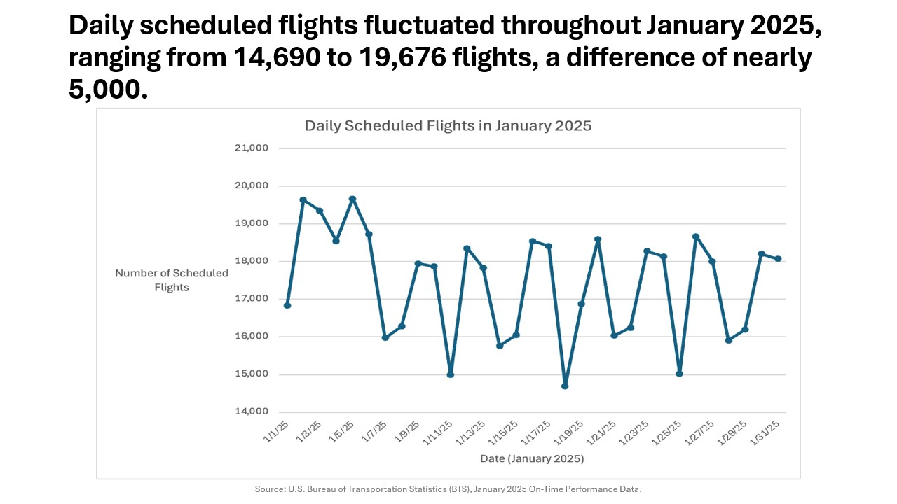
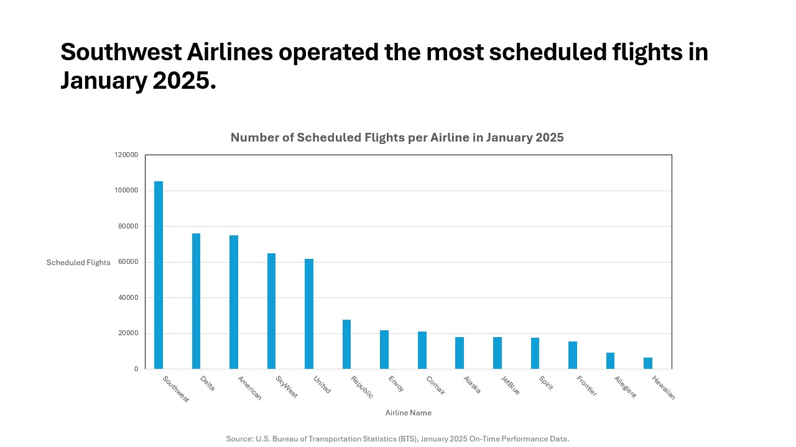
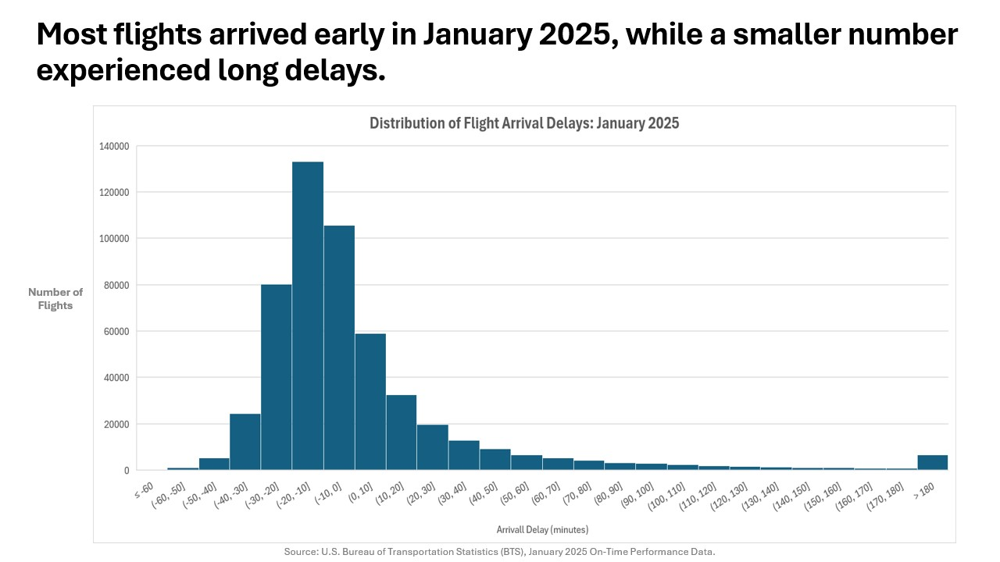
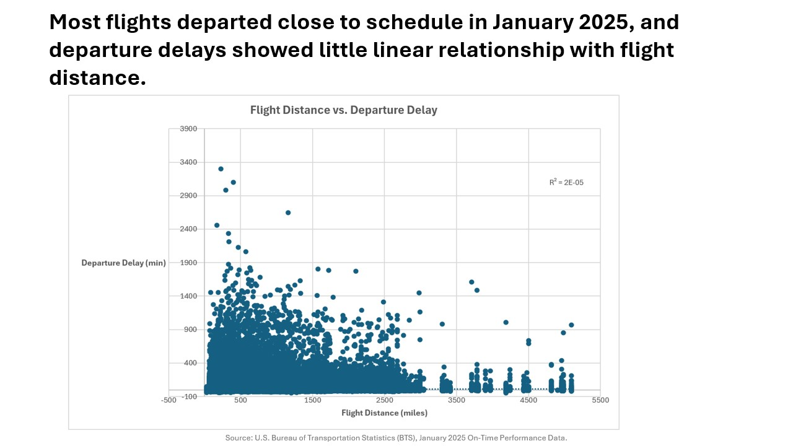

## Team members

- [Peyton Meierhoff](https://peytonm2007.github.io/)
- [Samuel Otterburg](https://samuelotterburg.github.io/)
- [Trevor Miller](https://tmiller2178.github.io/)
- [Mark Tudor](https://markt-07.github.io/)

## Dataset

Our team analyzed 539,747 scheduled U.S. commercial flight records from January 2025 in `INEG_21003_Flight_Data.xlsx`. The workbook includes flight dates, airlines, departure and arrival delays, cancellations, flight times, and distances. Delays are measured in minutes and distance is measured in miles. Negative delays mean a flight departed or arrived early.

[U.S. Bureau of Transportation Statistics, January 2025 Airline Service Quality Performance Data](https://www.bts.gov/newsroom/airline-service-quality-performance-data-january-2025)

## 1. How did the number of scheduled flights vary by day?

We wanted to see how much busier one day could be than another. A monthly total can hide differences that matter for staffing and gate assignments.

In Excel, we grouped the records by flight date and counted the scheduled flights for each day, including cancellations in the scheduled totals. January 5 had the most flights (19,676), and January 18 had the fewest (14,690).

We put the dates in order on the x-axis and the daily counts on the y-axis. Connecting the daily counts makes the peaks and dips easy to follow. The headline gives the range so readers can see the size of the difference before looking at the line.

{fig-alt="Line chart of scheduled flights by date, ranging from 14,690 on January 18 to 19,676 on January 5."}

## 2. Which airline scheduled the most flights?

We wanted to know whether the airlines had similar schedules or whether a few carriers accounted for much more of the month’s traffic.

In Excel, we counted the scheduled flight records for each airline and sorted the totals from highest to lowest. Southwest led with 105,307 scheduled flights, followed by Delta with 76,306 and American with 75,088.

We used one column per airline and started the count axis at zero so the column heights show the differences in flight volume. Ordering the columns from highest to lowest puts Southwest first, which supports the headline.

{fig-alt="Column chart of 14 airlines sorted by scheduled flight count, with Southwest first, followed by Delta and American."}

## 3. How were arrival delays distributed?

We wanted to know what a typical arrival looked like and how often passengers faced a much longer delay. An average alone would hide the spread.

In Excel, we used the 522,269 records with arrival delays and grouped them into 10-minute bins, with separate bins for the most extreme values. About 65% of those flights arrived early. The tallest bar represents flights that arrived roughly 10 to 20 minutes early, with 133,024 flights in that bin.

We used a histogram to show the number of flights in each delay interval. The bars to the left of zero show early arrivals, and the tail to the right shows how far late arrivals extended. The headline summarizes both patterns.

{fig-alt="Histogram of arrival delays, with the tallest bar between 20 and 10 minutes early and a long right tail for late arrivals."}

## 4. Is flight distance associated with how late a flight departs?

Longer flights can face different scheduling and operational conditions. We wanted to see whether flight distance could help predict departure delay.

In Excel, we made an XY scatter plot using the 523,824 records with both distance and departure delay. We kept negative delays so early departures were included. We added a linear trendline, which explained about 0.002% of the variation in departure delay (R² ≈ 0.000021).

Each dot represents a flight, with distance in miles on the x-axis and departure delay in minutes on the y-axis. We kept the full delay range visible and displayed R² on the chart. The headline describes the cluster near the scheduled departure time and the weak linear relationship.

{fig-alt="Scatter plot showing departures clustered near zero delay across flight distances. A few delays exceed 3,000 minutes, and the linear trendline has an R squared near 0.00002."}
